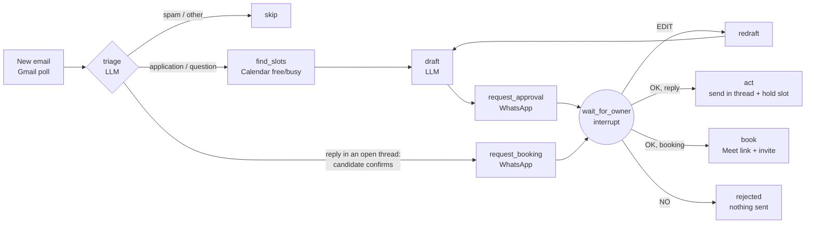

# Human-in-the-loop recruiting agent (LangGraph)

[](https://github.com/ahmedelalfiee/langgraph-hitl-recruiting-agent/actions/workflows/tests.yml)


An AI agent that runs a recruiter's candidate conversations **inside the tools they already use**
(Gmail, Google Calendar, WhatsApp) and never sends anything without a human's approval.

A candidate emails. The agent understands the email, finds real free slots in the recruiter's
calendar, drafts a reply, and **pauses**. The recruiter gets the draft on WhatsApp and replies
`OK`, `EDIT <change>` or `NO`. On approval, the reply goes out from their own Gmail and the slot is
held. When the candidate confirms, the agent asks once more and then books the interview with a
Google Meet link and a calendar invite.

<p align="center"></p>

## Why this is harder than it looks

Drafting a reply with an LLM takes one API call. The engineering is everything around it:

- a run that **waits hours** for a human, survives a restart, and resumes exactly where it stopped;
- **side effects that must happen once**: an email sent twice or a double-booked slot is worse than no automation;
- a conversation that **continues across emails** (the candidate's "yes, Tuesday works" must be tied to the offer it answers);
- failures that **don't lose work silently**.

## Architecture



| Module | Responsibility |
|---|---|
| `opzy/graph.py` | The `StateGraph`: nodes, routing, the `interrupt()` approval step |
| `opzy/engine.py` | One run per email (`thread_id` = email id); resumes runs with `Command(resume=...)` |
| `opzy/llm.py` | Triage, confirmation parsing and drafting; provider-agnostic (OpenAI or Anthropic) |
| `opzy/google_tools.py` | Gmail (poll, reply in thread, strip quoted text) and Calendar (free/busy, hold, book with Meet) |
| `opzy/memory.py` | SQLite: processed emails, approval codes, open conversation threads, audit log |
| `opzy/whatsapp.py` | Twilio WhatsApp + parsing of `OK / EDIT / NO [CODE]` |
| `opzy/app.py` | FastAPI service: background Gmail poller + signed WhatsApp webhook |
| `business.yaml` | Per-client config: roles, tone, working hours, interview settings, signature |

## Design decisions

**1. Durable pauses with a checkpointer.** Approval is a LangGraph `interrupt()` backed by a
`SqliteSaver`. A pending approval is just persisted graph state, so the process can restart and
the owner's `OK` the next morning still resumes the right run (`test_resume_survives_restart`).

**2. Side effects live in their own nodes.** When a run resumes, LangGraph re-executes the
interrupted node from the top. If sending the email lived in the same node as the interrupt, the
candidate would get it twice. So `wait_for_owner` does nothing but wait, and every irreversible
action (`act`, `book`) runs in a node after it.

**3. Every side effect has an idempotency key.** A node can still fail halfway: the email goes
out, then the calendar call times out. The approval stays pending, the owner gets a warning, and
`OK <code>` retries the node. Each side effect inside it runs through `once()` with a key of
*run + approval code + step*, so the retry skips what already happened. The result is stored after
the call, which leaves a small gap (the process dies right after Gmail accepts the email), so the
same key also goes to Google: it travels in an `X-Opzy-Key` header that is checked in the thread
before sending, and becomes a fixed Calendar event id, which Calendar refuses to insert twice
(so a candidate can never get two invites). An `EDIT` creates a new approval code, so an edited
draft gets new keys and is really sent.

**4. Approval codes, not "the latest message".** Each pending decision gets a short code
(`OK A3F2`), so an owner with several drafts waiting can't approve the wrong one. A bare `OK`
falls back to the most recent.

**5. Conversations, not single emails.** After the agent replies, it stores the thread, the slots
it offered and the calendar hold. When the candidate answers, triage recognises the thread and an
LLM classifies the answer as *confirm / reschedule / decline / other*. A confirmation goes to
booking (deleting the hold first); a reschedule produces a fresh offer and replaces the old hold.

**6. Fail loudly, retry safely.** An email is marked as processed before its run starts (so two
polls can't race), but if the run fails before reaching the owner, the mark is removed and the next
poll retries it. One bad email never blocks the others (`test_failed_email_is_retried`).

**7. Least privilege at the edges.** Gmail reading is scoped by a query (e.g. one alias), and
the WhatsApp webhook ignores anyone but the owner's number and verifies Twilio's request
signature when a public URL is configured.

**8. Model-agnostic.** The two LLM jobs sit behind a small interface with OpenAI and Anthropic
implementations, picked from whichever key is configured.

## Tests

35 tests (the end-to-end flows plus the eval scorers) run against fake Gmail, Calendar, WhatsApp and LLM, so no keys are needed:

```bash
pip install -r requirements.txt
python -m pytest -q        # 35 passed
```

They cover the guarantees that matter:

| Guarantee | Test |
|---|---|
| Nothing is sent before approval | `test_nothing_sent_before_approval` |
| Approve sends the reply and holds the slot | `test_approve_sends_and_books` |
| `EDIT` redrafts and asks again | `test_edit_redrafts_then_asks_again` |
| `NO` sends nothing | `test_reject_sends_nothing`, `test_owner_can_refuse_booking` |
| The same email is handled once | `test_same_email_only_once` |
| A pending approval survives a restart | `test_resume_survives_restart` |
| A failed email is retried, not lost | `test_failed_email_is_retried` |
| Retrying a half-finished action doesn't email the candidate twice | `test_retry_after_crash_does_not_resend_email` |
| Even a crash right after Gmail accepts the email can't cause a resend | `test_crash_before_the_send_is_recorded_does_not_resend` |
| Retrying a booking sends one invite | `test_booking_retry_sends_one_invite` |
| Candidate confirms, owner approves, interview booked | `test_candidate_confirms_then_owner_books` |
| Candidate asks for another time, gets a new offer | `test_candidate_asks_other_time_gets_new_offer` |
| Slots skip busy times and weekends | `test_pick_slots_skips_busy_and_weekends` |
| The webhook ignores anyone but the owner | `test_webhook` |

## Evals

The unit tests prove the plumbing. The evals measure the part that can't be unit-tested: the
model's judgement. `evals/cases/` holds 62 labelled cases for the three LLM jobs:

| Suite | Cases | What is checked |
|---|---|---|
| `triage` | 30 | kind (application, question, spam, other), role matched to an open role, candidate's first name. Includes roles that aren't open, a Portuguese email, a job-board relay, a referral and a withdrawal |
| `confirm` | 20 | confirm / reschedule / decline / other, and *which* slot was accepted. Includes "Tuesday works, but 16:00?", "Either works" and a Portuguese reply |
| `draft` | 12 | offers the first free slot, **never mentions a time or day that wasn't offered**, no slot offered to a question or a closed role, Meet link mentioned, signature exact, 60 to 110 words, no em dashes or markdown |

Drafts are scored with deterministic checks rather than an LLM judge, so a failure points at a
specific rule. The scorers have their own tests (`tests/test_evals.py`), including a check that a
model answering with the labels scores 100%.

```bash
python -m evals.run                    # all suites, model from .env
python -m evals.run --suite draft      # one suite
```

It prints the pass rate per check, latency and cost per 1,000 tasks, writes
`evals/results/<model>.json`, and exits non-zero if a suite falls below `evals/thresholds.json`.
The `evals` workflow runs it on every pull request that touches a prompt, the business profile or
the evals (it needs an `OPENAI_API_KEY` repository secret).

## Run it

Requires Python 3.11+, a Google Cloud OAuth client (Gmail + Calendar APIs), a Twilio WhatsApp
sandbox, and an OpenAI or Anthropic key.

```bash
python -m venv .venv && source .venv/bin/activate   # Windows: .venv\Scripts\activate
pip install -r requirements.txt
cp .env.example .env              # add your keys; never commit .env
python -m opzy.auth               # one-time Google sign-in (creates token.json locally)
python -m opzy.cli                # terminal mode: approve drafts by typing OK / EDIT / NO
```

For WhatsApp approvals, run the service and expose it (e.g. with ngrok), then point the Twilio
sandbox's incoming-message webhook at `https://<public-url>/whatsapp`:

```bash
uvicorn opzy.app:app --port 8000
```

Edit `business.yaml` for your business: roles, tone, working hours, interview length and
signature. Set `GMAIL_QUERY` so the agent only reads the emails it should.

## Limitations and next steps

- Gmail is polled; Gmail push notifications (Pub/Sub) would cut latency and API calls.
- The Twilio sandbox needs re-joining every 72 hours; production would use the WhatsApp Business
  Platform with interactive Approve / Edit buttons.
- Triage quality is checked by tests with a fake LLM. A labelled set of real emails, scored per
  model and prompt version, is the next step for measuring it properly.
- One business per deployment; multi-tenant storage and per-client OAuth are next.

## License

MIT
